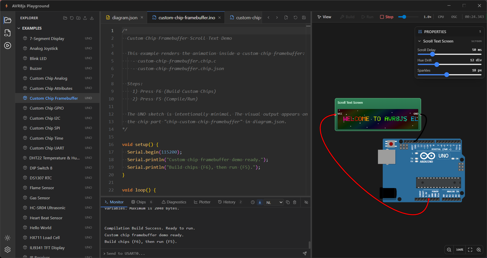

# AVR8js Electron Playground

A desktop Arduino simulator for AVR boards. Write sketches, wire virtual circuits, and see how components respond as your code runs.



## Run locally

Install Git and Node.js 24 with npm. [Download Node.js](https://nodejs.org/en/download)

```sh
git clone https://github.com/arcostasi/avr8js-electron-playground.git
cd avr8js-electron-playground
npm ci
npm run build
npm start
```

Open **Blink LED** from the project sidebar, then click **Build** and **Run** in the simulator toolbar. The default compiler, **Wokwi Cloud (Hexi)**, requires an internet connection. [Blink LED example](examples/blink-led/)

## What you can do

- Edit Arduino sketches and `diagram.json` files in a tabbed code editor.
- Build circuits for Arduino Uno, Nano, and Mega with virtual sensors, displays, motors, and NeoPixels.
- Inspect serial traffic, signals, and AVR registers with the Serial Monitor, Serial Plotter, Oscilloscope, and AVR Inspector.
- Open bundled examples, import or export `.avr8js` project bundles, and run WebAssembly custom chips. [Examples](examples/) · [Custom chip example](examples/custom-chip-gpio/)
- Embed an external visualization with the `customView` field in `diagram.json`. The simulator forwards NeoPixel frames and serial output to the view. [LED Cube example](examples/led-3d-cube-custom-view/) · [Live 3D viewer](https://arcostasi.github.io/led-3d-cube/?size=8)

## Compile with Arduino CLI

For local sketch compilation, install Arduino CLI and add the AVR board core. [Arduino CLI installation](https://docs.arduino.cc/arduino-cli/installation/)

```sh
arduino-cli core update-index
arduino-cli core install arduino:avr
```

In **Settings → Build**, choose **Local arduino-cli** and set the installation folder to the directory containing the executable. Install any additional libraries the sketch requires.

## Development checks

```sh
npm run lint
npm test
npm run test:perf-smoke
```

## Credits

- **Simulation and virtual components.** The AVR emulator and circuit elements come from the Wokwi open-source projects. [AVR8js](https://github.com/wokwi/avr8js) · [Wokwi Elements](https://github.com/wokwi/wokwi-elements)
- **Desktop, editor, and interface.** [Electron](https://github.com/electron/electron) · [Monaco Editor](https://github.com/microsoft/monaco-editor) · [React](https://github.com/react/react) · [Zustand](https://github.com/pmndrs/zustand) · [Tailwind CSS](https://github.com/tailwindlabs/tailwindcss) · [Lucide](https://github.com/lucide-icons/lucide) · [Split.js](https://github.com/nathancahill/split) · [Custom Electron Titlebar](https://github.com/AlexTorresDev/custom-electron-titlebar)
- **Build and testing.** [TypeScript](https://github.com/microsoft/TypeScript) · [Vite](https://github.com/vitejs/vite) · [ESLint](https://github.com/eslint/eslint) · [Vitest](https://github.com/vitest-dev/vitest)
